# Neuroimaging Robot Powered by Brain Foundation Models

An AI-powered neuroimaging research project for classifying brain MRI volumes using a fine-tuned BrainIAC-based 3D Vision Transformer (ViT-B), with inference deployed on an NVIDIA Jetson AGX Orin.

The project integrates volumetric MRI preprocessing, model fine-tuning, evaluation, ONNX export, and a graphical application for visualizing predictions and MRI views.

## Project Highlights

- **Model:** BrainIAC-based 3D Vision Transformer (ViT-B)
- **Task:** Four-class brain MRI classification
- **Input:** Volumetric MRI data in NIfTI format
- **Inference:** ONNX-based model deployment
- **Hardware:** NVIDIA Jetson AGX Orin
- **Interface:** GUI displayed on a connected monitor and operated using a keyboard and mouse
- **Outputs:** Predicted class, classification scores, and axial, coronal, and sagittal MRI views

## Hardware Deployment

The completed application runs on the NVIDIA Jetson AGX Orin. The GUI is displayed on an external monitor and operated using a keyboard and mouse. A touchscreen is not used.


*Hardware used for the deployed neuroimaging application.*

## Classification Categories

The model classifies MRI volumes into four categories:

| Class | Description |
|---|---|
| Normal | MRI volume assigned to the normal category |
| Mild Cognitive Impairment (MCI) | MRI volume assigned to the MCI category |
| Alzheimer's disease | MRI volume assigned to the Alzheimer's category |
| Stroke | MRI volume assigned to the stroke category |

These are model output categories for an academic research prototype, not clinical diagnoses.

## System Workflow

1. Prepare labelled brain MRI volumes in NIfTI format.
2. Apply the required MRI preprocessing.
3. Fine-tune the BrainIAC-based 3D ViT-B model.
4. Evaluate the classifier using the project evaluation workflow.
5. Export the model to ONNX format.
6. Run the inference application on the NVIDIA Jetson AGX Orin.
7. Display the predicted class, classification scores, and orthogonal MRI views through the GUI.

## Output Gallery

The following screenshots illustrate example outputs from the project's classification application.

### Normal

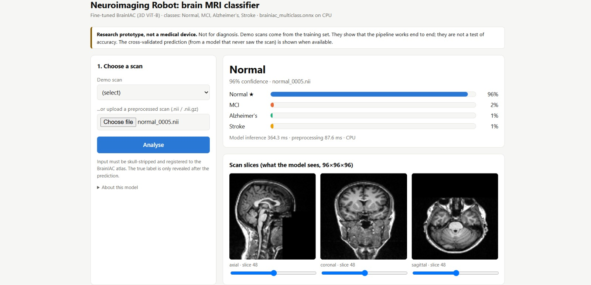

### Mild Cognitive Impairment (MCI)

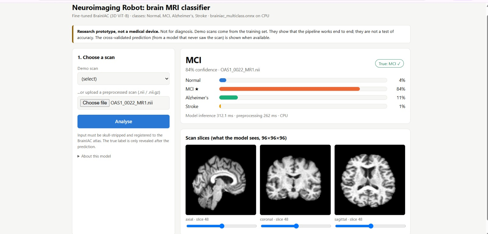

### Alzheimer's Disease

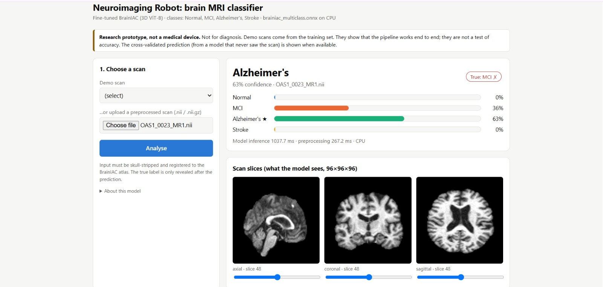

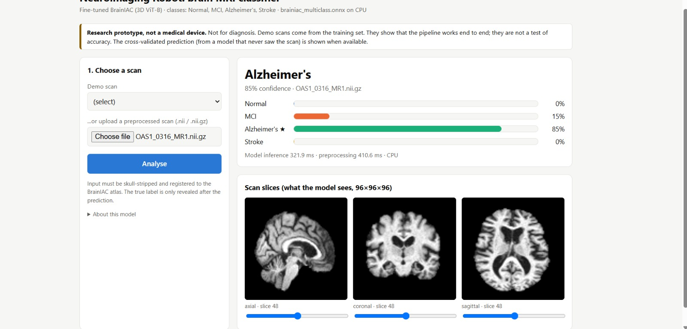

### Stroke

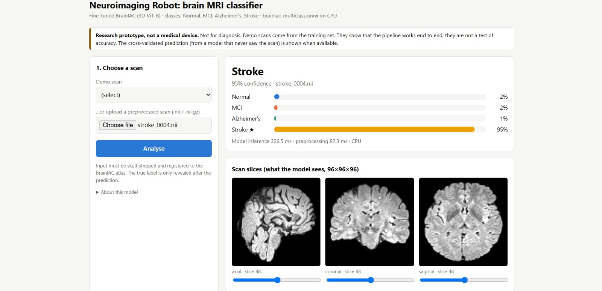

The displayed predictions are examples from the application. They demonstrate the interface and its output format; they should not be interpreted as evidence of clinical diagnostic performance.

## Model Evaluation and Visualizations

The repository includes visualizations generated during model development and evaluation.

### Dataset Distribution

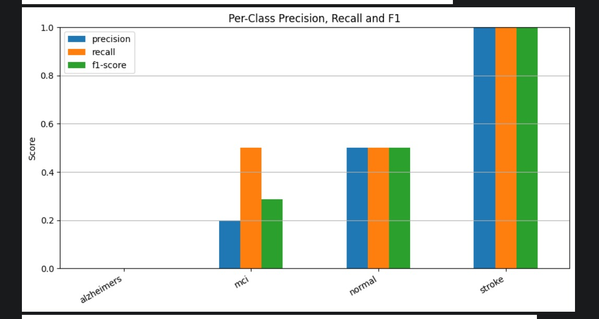

### Training Metrics

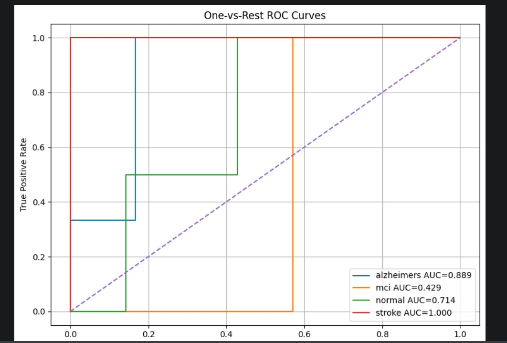

### Test Evaluation

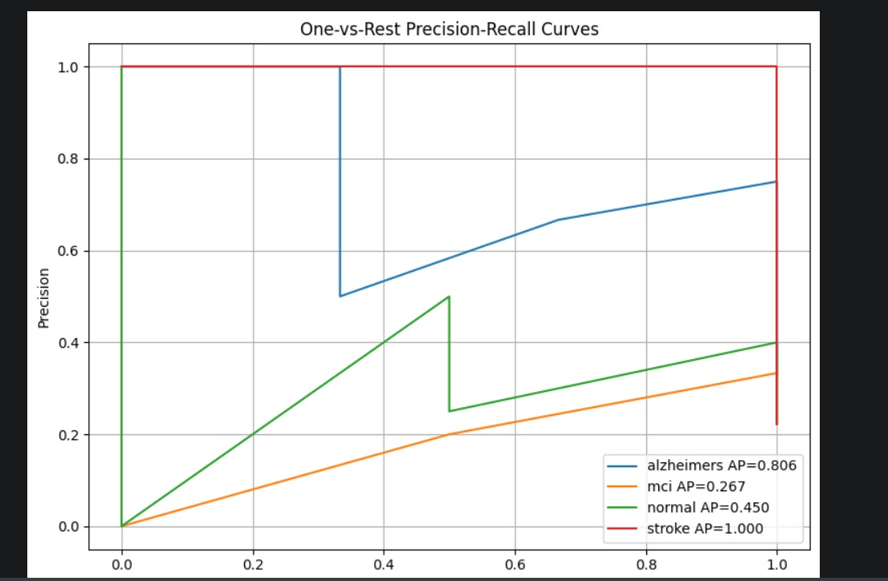

### ROC Curves

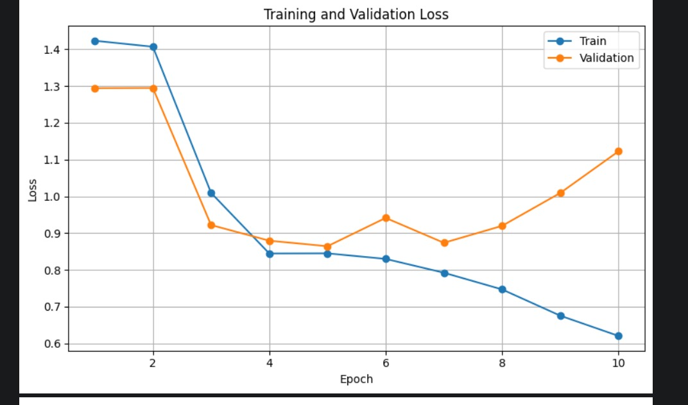

### Precision–Recall Curves

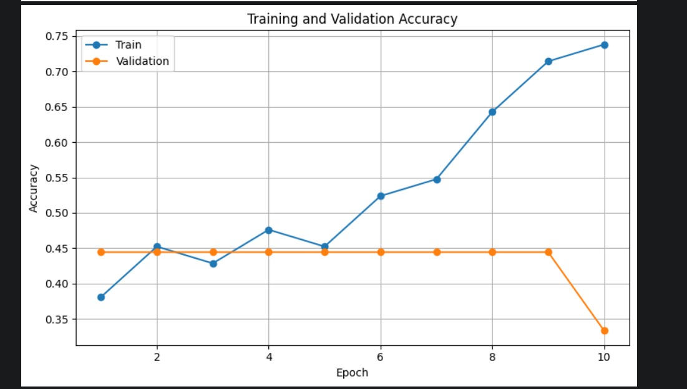

These figures should be interpreted alongside the project report and evaluation methodology. The dataset is limited in size, and the results do not establish generalization to broader clinical populations.

## Model Package

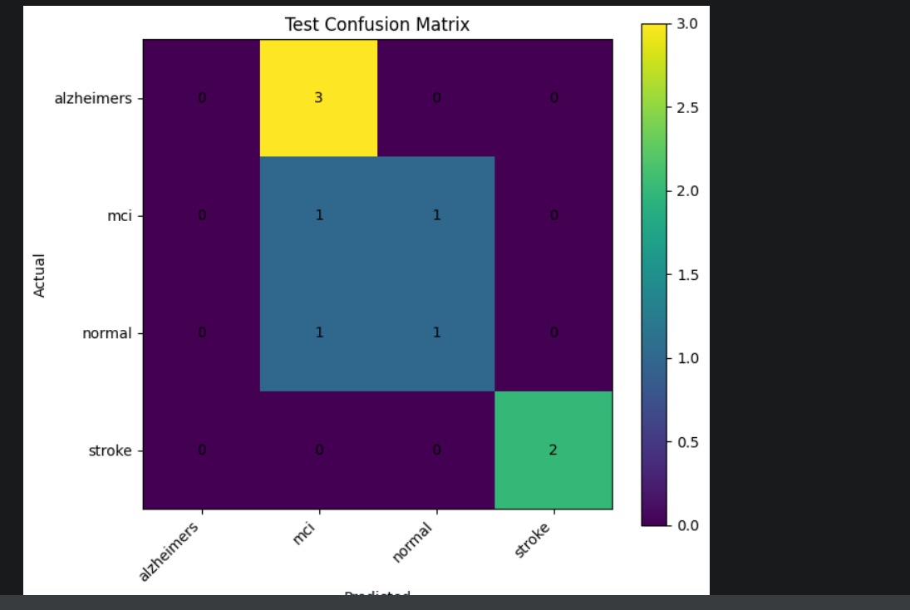

The exported ONNX model and packaged deployment artifacts are hosted separately because of their file sizes. Refer to the project artifacts link below for access.

## Repository Structure

```text
brainiac/
├── app/
│   └── jetson_gui_app.py
├── assets/
│   ├── NVIDIA Jetson AGX Orin.jpeg
│   ├── normal_prediction.png
│   ├── mci_prediction.png
│   ├── alzheimers_prediction_1.png
│   ├── alzheimers_prediction_2.png
│   ├── stroke_prediction.png
│   └── evaluation visualizations
├── data/
│   └── by_class.zip                 # Hosted separately
├── docs/
│   ├── Neuroimaging_Robot_BrainIAC_Jetson_Implementation_Roadmap(3).docx
│   └── Neuroimaging_Robot_Report_Srinjay_Sarkar.pdf
├── models/
│   ├── brainiac_multiclass.onnx     # Hosted separately
│   └── jetson_package_4class.zip    # Hosted separately
├── notebooks/
│   └── notebook0384ac332b.ipynb
├── .gitignore
└── README.md
```

## Dataset

The prepared project dataset contains **60 MRI volumes**, with 15 volumes per class across the four categories.

The dataset archive is hosted separately due to its size. Please consult the project documentation for details about the dataset, preprocessing, and evaluation methodology.

## Deployment

The application has been deployed on an NVIDIA Jetson AGX Orin. A connected monitor displays the graphical interface, operated using a keyboard and mouse.

The application source code and implementation roadmap are included in this repository. Refer to those files for implementation and environment details.

## Project Artifacts

**Google Drive:** [Access the complete project files](https://drive.google.com/drive/folders/1ISF30wpHTtsws32YH2VQdwa2VKH58RGM?usp=sharing)

The shared folder contains the large dataset and model artifacts that are not tracked in this Git repository:

- `by_class.zip` — prepared MRI dataset
- `brainiac_multiclass.onnx` — exported ONNX model
- `jetson_package_4class.zip` — packaged model and deployment artifacts

Access depends on the Google Drive sharing permissions.

## Limitations and Responsible Use

This project is an academic research prototype and has not been established as a clinically validated diagnostic system. Dataset size, data composition, evaluation methodology, and generalization limitations must be considered when interpreting its results.

Predictions must not be used as a substitute for assessment by qualified healthcare professionals.

## Team

- Srinjay Sarkar
- Sujatra Biswas
- Mahargha Kundu

**Faculty Guide:** Dr. Shridevi S

School of Computer Science and Engineering  
Vellore Institute of Technology, Chennai, India

## Acknowledgements

We thank our faculty guide, Dr. Shridevi S, for her guidance and support throughout this project.
